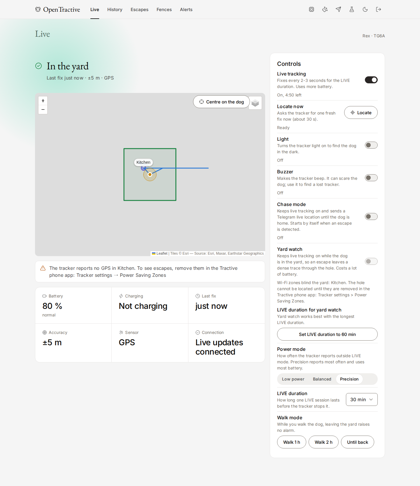
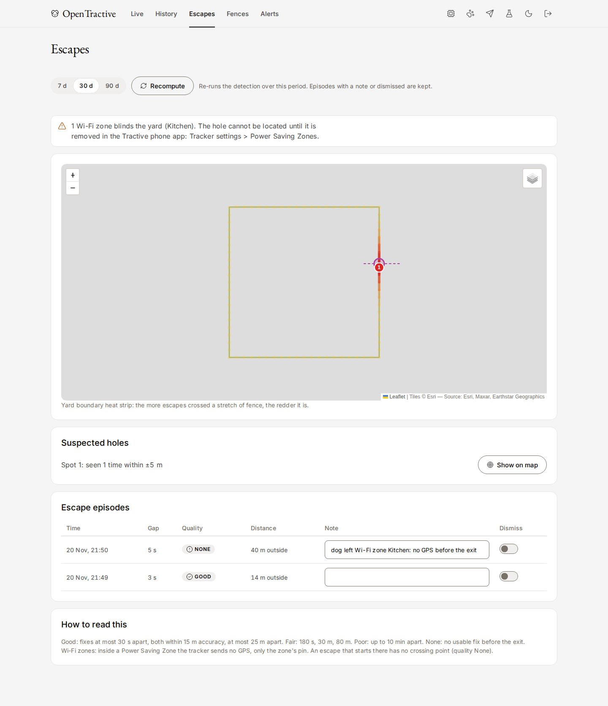
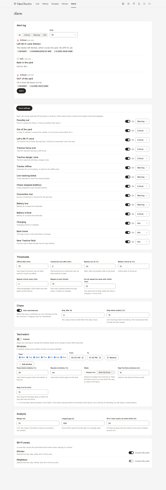
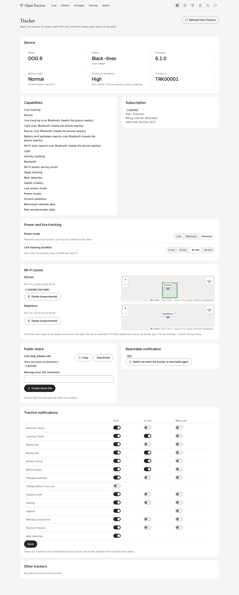
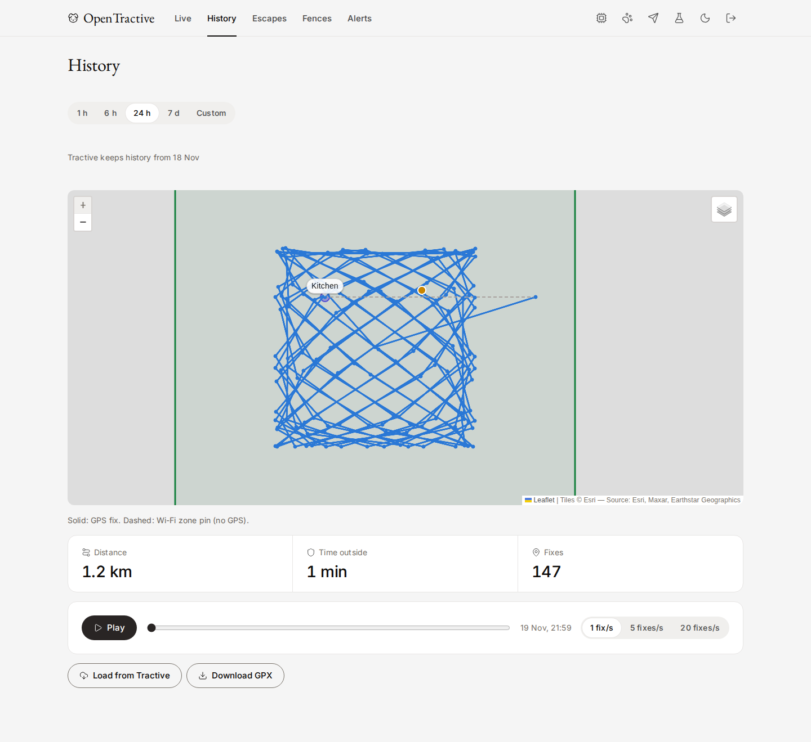
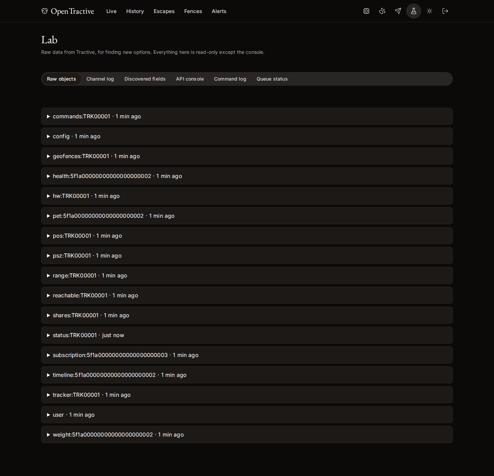
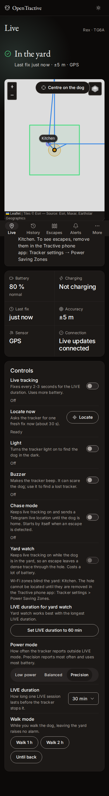
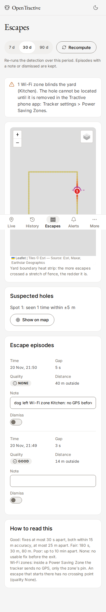

# OpenTractive

Self-hosted monitor for Tractive pet GPS trackers: live map, escape alarms, a hole finder for your fence, and a Telegram bot. You draw the yard, and OpenTractive alerts you within seconds when the pet leaves it, estimates where it crossed the fence, and can switch on live tracking to chase it. It runs as one small Node.js container with a SQLite database and talks to Tractive through its unofficial API.

## Features

- Live map with every tracker control, including ones the Tractive app hides: locate now, power mode, LIVE duration, geofence editing, public share and notification settings.
- Escape alarms with incidents that repeat until acknowledged, and chase mode with a Telegram live location.
- Yard watch (keeps live tracking on while the pet is in the yard) and walk mode (no alarm while you walk the pet).
- Hole finder: estimated crossing point of each escape and a heat strip along the fence.
- History with GPX export.
- Telegram bot in private chats and groups.
- Lab: raw Tractive objects, channel log, unknown-field detector and an API console.

## Screenshots

Synthetic mock data only.








 

## Quick start

1. `cp .env.example .env`, then set `TRACTIVE_EMAIL`, `TRACTIVE_PASSWORD` and `APP_PASSWORD` (8+ characters). Optionally set `TELEGRAM_BOT_TOKEN`.
2. `chmod 600 .env && mkdir -p data`
3. `docker compose up -d --build`
4. Open `http://127.0.0.1:8090` and log in with `APP_PASSWORD`. Health check: `curl -s 127.0.0.1:8090/healthz`

Tractive accounts that only use Google or Apple sign-in do not work; set a password on the account first.

## Environment variables

Defined in `.env.example`. An empty default means the setting is off or taken from another source.

| Variable | Default | Meaning |
|---|---|---|
| `TRACTIVE_EMAIL` | empty (required) | Tractive account email. Google or Apple-only accounts do not work. |
| `TRACTIVE_PASSWORD` | empty (required) | Tractive account password. |
| `APP_PASSWORD` | empty (required) | Password of this web app. The server refuses to start without it. Changing it logs everyone out. |
| `TRACTIVE_TRACKER_ID` | empty | Which tracker to follow (8 characters). Empty: the first tracker with an active subscription. |
| `TELEGRAM_BOT_TOKEN` | empty | Telegram bot token. Empty turns the bot off. |
| `TELEGRAM_BOT_NAME` | empty | Bot name shown in the UI until the bot answers `getMe`. |
| `TELEGRAM_CHAT_IDS` | empty | Comma-separated chat ids approved at start. Pairing from the web app also works. |
| `APP_URL` | empty | Public URL of this app; used for links in Telegram messages. |
| `OT_BIND` | `127.0.0.1` | Host address published by docker compose. |
| `OT_PORT` | `8090` | Host port published by docker compose. |
| `TRUST_PROXY` | empty | Set to `1` only behind a reverse proxy. It trusts `X-Forwarded-For`, `-Proto` and `-Host`. |
| `TZ` | `UTC` | IANA time zone, e.g. `Europe/Madrid`. Used for windows, days and display. |
| `TRACTIVE_MIN_GAP_MS` | `5000` | Minimum milliseconds between Tractive REST requests. Use `8000` if you see rate limits. |
| `TRACTIVE_CLIENT_ID` | `625e533dc3c3b41c28a669f0` | Client id sent to Tractive at login. Keep the default. |
| `TRACTIVE_GRAPH_URL` | `https://graph.tractive.com/4` | Tractive graph REST base URL. |
| `TRACTIVE_CHANNEL_URL` | `https://channel.tractive.com/3/channel` | Tractive live channel (push) URL. |
| `TRACTIVE_APS_URL` | `https://aps-api.tractive.com/api/1` | Tractive APS API base URL (health data). |
| `TRACTIVE_TIMELINE_URL` | `https://prod.eu-central-1.event-timeline-api.tractive.com/api/1` | Tractive timeline API base URL. |
| `TELEGRAM_API_URL` | `https://api.telegram.org` | Telegram Bot API base URL. |
| `DATA_DIR` | `data` | Directory of the SQLite database (`/app/data` in the image). |
| `HOST` | `127.0.0.1` | Listen address inside the process (`0.0.0.0` in the image). |
| `PORT` | `8080` | Listen port inside the process. |
| `PROBE_DELAY_MS` | `8000` | Delay between requests of `scripts/probe.mjs`. |

## Behind a reverse proxy

Keep `OT_BIND=127.0.0.1` and publish the port through your proxy, or set `OT_BIND`/`OT_PORT` to match your network. Set `TRUST_PROXY=1` so the app trusts `X-Forwarded-For`, `-Proto` and `-Host`, and set `APP_URL` to the public URL. Terminate HTTPS at the proxy and forward the `Host` and `Origin` headers unchanged (the API checks that they match). The live stream uses SSE, so disable response buffering for it.

## Telegram

1. Create a bot with `@BotFather` and put its token in `TELEGRAM_BOT_TOKEN`, then restart the app.
2. Open the Telegram page in the app and generate a pairing code.
3. Send `/start <code>` to the bot in a private chat, or `/start@<botname> <code>` in a group.

Every member of a paired group can use every command. Commands:

```
/status   where the pet is, battery, last fix and modes
/where    last position on the map
/live on|off      live tracking
/locate   ask the tracker for a fresh position
/led on|off       tracker light
/buzz on|off      tracker buzzer
/chase on|off     chase mode with a live location
/watch on|off     yard watch
/walk [minutes]|off   walk mode (default 120 min)
/mute <minutes>   mute info and warning alerts (1-720)
/mute all <minutes>   mute every alert, critical included
/unmute   end a mute
/escapes  last escapes
/help     this list
```

## Endpoint checklist

Each Tractive endpoint the app uses, the client method that calls it, and where it appears in the UI. The "Verified" column records checks against a real account. Write and command endpoints are marked "not yet" until a live smoke test has run them.

| Tractive endpoint | Client method | UI place | Verified |
|---|---|---|---|
| POST graph `auth/token` | `login()` | automatic; Live "Retry login"; Lab > Queue | 2026-11-20 (probe) |
| GET `user/{uid}` | `user()` | Tracker > Tractive notifications; Lab > Raw | 2026-11-20 (read) |
| PUT `user/{uid}?_version=` | `updateUser()` | Tracker > Tractive notifications > Save | not yet |
| GET `user/{uid}/trackers` | `trackers()` | Tracker > Other trackers | 2026-11-20 (read) |
| GET `tracker/{id}` | `tracker()` | Tracker > Device, Capabilities | 2026-11-20 (read) |
| GET `device_hw_report/{id}/` | `hwReport()` | Lab > Raw (`hw:<id>`) | 2026-11-20 (read) |
| GET `device_pos_report/{id}` | `posReport()` | Lab > Raw (`pos:<id>`) | 2026-11-20 (read) |
| GET `user/{uid}/trackable_objects` | `pets()` | Pet | 2026-11-20 (read) |
| GET `trackable_object/{id}` | `pet()` | Pet > Profile | 2026-11-20 (read) |
| PUT `trackable_object/{id}?_version=` | `updatePet()` | Pet > Edit | not yet |
| GET `user/{uid}/subscriptions` | `subscriptions()` | Tracker > Subscription | 2026-11-20 (read) |
| GET `subscription/{id}` | `subscription()` | Tracker > Subscription | 2026-11-20 (read) |
| POST `bulk?partial=1` | `bulk()` | used by fences, zones, shares, command states; Lab > Console | 2026-11-20 (read) |
| GET `tracker/{id}/geofences` + bulk | `geofences()` | Fences | 2026-11-20 (read) |
| POST `geofence/tracker/{id}/geofences` | `createGeofence()` | Fences > Draw | not yet |
| PUT `geofence/{gid}?_version=` | `updateGeofence()` | Fences > rename, type, active, icon, edit shape | not yet |
| DELETE `geofence/{gid}` | `deleteGeofence()` | Fences > Delete | not yet |
| GET `tracker/{id}/power_saving_zones`, `power_saving_zone/{zid}` | `powerSavingZones()` | Tracker > Wi-Fi zones; Live map pins | 2026-11-20 (read) |
| DELETE `power_saving_zone/{zid}` | `deletePowerSavingZone()` | Tracker > Wi-Fi zones > Delete (experimental) | 2026-11-20 (on a test zone) |
| PUT `power_saving_zone/{zid}?_version=` | `updatePowerSavingZone()` | Tracker > Wi-Fi zones > Switch off/on; Telegram `/zone`; Yard watch automatic mode | 2026-11-20 |
| POST `power_saving_zone/tracker/power_saving_zones/{id}` | (not used by the app) creates a zone from `{zone_id: <Wi-Fi name>, latlong, name, source: "WIFI"}` without the phone's Wi-Fi scan | Lab > Console | 2026-11-20 (on a test zone) |
| bulk `tracker_command_state` | `commandStates()` | Live controls | 2026-11-20 (read) |
| GET `tracker/{id}/command/live_tracking/{on,off}` | `command()` via the reconciler | Live > Live tracking; Telegram `/live` | not yet |
| GET `tracker/{id}/command/led_control/{on,off}` | `command()` | Live > Light; Telegram `/led` | 2026-11-20 (on and off: HTTP 200; pending while in a Wi-Fi zone) |
| GET `tracker/{id}/command/buzzer_control/{on,off}` | `command()` | Live > Buzzer; Telegram `/buzz` | not yet |
| GET `tracker/{id}/command/pos_request/on` | `command()` | Live > Locate now; Telegram `/locate`; chase | not yet |
| PUT `tracker/{id}/power_mode` | `setPowerMode()` | Live, Tracker > Power mode | not yet |
| PUT `tracker/{id}/lt_timeout` | `setLiveTimeout()` | Live, Tracker > LIVE duration | not yet |
| GET `tracker/{id}/positions/range` | `positionsRange()` | History hint | 2026-11-20 (read) |
| GET `tracker/{id}/positions` | `positions()` | History > Load from Tractive; startup 48 h; hourly catch-up | 2026-11-20 (read) |
| GET `tracker/{id}/public_shares` + bulk | `publicShares()` | Tracker > Public share | 2026-11-20 (read) |
| POST `public_share` | `createPublicShare()` | Tracker > Create share link | not yet |
| PUT `public_share/{sid}/deactivate` | `deactivatePublicShare()` | Tracker > Deactivate | not yet |
| GET `tracker/{id}/event_notification/tracker_reachable_again` | `reachableNotification()` | Tracker > Reachable | 2026-11-20 (read) |
| POST same | `setReachableNotification()` | Tracker > Notify me | not yet |
| GET `weight_activity_history/{petId}` | `weightHistory()` | Pet > Weight | 2026-11-20 (read) |
| GET aps `pet/{petId}/health/overview` | `health()` | Pet > Health | 2026-11-20 (read) |
| GET timeline `events` | `timeline()` | Pet > Timeline; `fence_exit`/`danger_enter` alerts | 2026-11-20 (read) |
| GET `config/all` | `config()` | Lab > Raw | 2026-11-20 (read) |
| GET `media/resource/{id}.jpg` | `petPhoto()` | Pet > Photo | not yet |
| POST channel `3/channel` | `startChannel()` | Live (every live value); Lab > Channel | 2026-11-20 (read) |
| any graph/aps/timeline path | `raw()` | Lab > Console | not yet |

## Wi-Fi zone switch

Inside a Wi-Fi zone (Tractive's Power Saving Zone) the tracker reports no GPS, so an escape through a hole in a yard that the home Wi-Fi reaches leaves no trace. A zone is matched by the Wi-Fi network name stored in its `zone_id`. The app switches a zone off by renaming that field to the network name plus `~ot-off` (a name no network has) and switches it back on by restoring the name; the zone keeps its id, pin and name. The original name is stored before every change, and the marker alone is enough to restore it.

- Tracker > Wi-Fi zones: a switch per zone with its status ("Off since 22:50, waiting for the tracker to move", then "GPS confirmed at 09:14").
- Telegram: `/zone` lists the zones, `/zone off` and `/zone on` switch the zones that cover the yard, `/zone off <name>` one zone.
- Alerts > Yard watch: "Switch off the Wi-Fi zones that cover the yard" switches them off when a Yard watch window starts and back on when it ends (and after a restart outside a window). Manual switches are left alone.

The tracker applies a change the next time it moves: a still tracker sleeps for hours and talks to nobody. The first GPS fix after a zone went off is recorded as the confirmation and raises an info alert. A switched-off zone costs battery while the tracker is in its range.

## How escape detection works

Each position fix is classed as `inside`, `outside`, `uncertain` or `psz` (a Wi-Fi zone pin, which has no GPS). An escape starts at the first `outside` fix after the pet was home, and it is confirmed only if it is not an isolated outlier. The crossing point is where the path between the last inside fix and the first fix past the fence meets the fence. Its quality is `good`, `fair`, `poor` or `none` (no crossing point), based on the time gap, accuracy and segment length. The heat strip shows where along the fence escapes happen. Crossing, quality and the heat strip are computed on request and never stored.

**Wi-Fi zone caveat.** Inside a Power Saving Zone the tracker sends no GPS, only the zone's pin. If a zone covers the yard, an escape that starts there is still detected, but it has no crossing point (quality `none`). To find the hole, remove the Wi-Fi zones that cover the yard in the Tractive phone app (Tracker settings > Power Saving Zones).

## Tractive API notes

- The API is unofficial and may change without notice.
- Rate limiting: the default `TRACTIVE_MIN_GAP_MS=5000` spacing gave no HTTP 429 in testing, while 1.2 s spacing gave many. Raise it to `8000` if the Lab shows rate limits.
- Locate now (`pos_request`) requires the account setting `pos_request_allowed`; otherwise Tractive answers 400 and the app disables the control.
- Yard watch keeps live tracking on and can empty the battery in about a day.

## Operations

- Backups: copy `data/` (database, token cache, photos; files are mode 600).
- Logs: `docker compose logs -f opentractive`
- Upgrade: `git pull && docker compose up -d --build`

## Development and tests

- `npm install`, then `npm test` for the unit tests. `npm run mock` starts a local Tractive and Telegram mock; never point tests at the real APIs.
- Unit tests in Docker: `docker compose -p ot-test --profile test run --rm --build unit`
- End-to-end tests (Playwright against the mock): `docker compose -p ot-e2e --profile e2e up --build --abort-on-container-exit --exit-code-from playwright mock app-e2e playwright`. Always pass the service list, otherwise the real app starts too. Clean up with `docker compose -p ot-e2e --profile e2e down -v`.
- `node scripts/check-fixtures.mjs` compares the mock fixtures with the shapes written by `scripts/probe.mjs`.

## Disclaimer

OpenTractive is not affiliated with Tractive. It uses an unofficial API that may change or stop working at any time. Use it at your own risk; do not rely on it as your only way to find a lost pet.

## License

MIT
